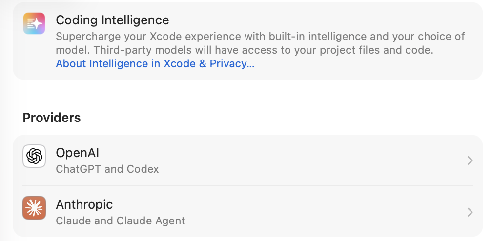

某天无聊翻看苹果的技术文档，发现了一个Wi-Fi Aware (NAN - Neighbor Awareness Networking)的技术，正好是我感兴趣的内容。听说苹果的AirDrop 就是利用这个技术实现的，欧盟后来强制要求苹果开放这个协议，所以我就问了Claude 几个相关问题，结合自己猜测可以应用的点，AI就帮我规划出了整个App的架构设计出来。



我一开始以后Wifi Aware 需要在一个Wifi 网络下，经过AI解答，根本不需要Wifi 网络，Wi-Fi Aware的核心优势和设计目标就是无需任何基础设施（路由器、AP、热点）即可通信。好家伙！它完全是一个点对点的无线通信神器。

- - -

它和传统Wi-Fi通信的对比：

```
传统 WiFi 通信：
手机 ──► 路由器 ──► 主机
        (必须同一网络)

Wi-Fi Aware：
手机 ◄──────────────► 主机
      直接点对点通信
    (无需路由器/热点)
```

NAN网络是如何建立链接的？

设备通过 **2.4GHz 信道** 周期性广播/扫描 NAN 发现窗口（Discovery Window），只要两台设备在 **WiFi 射频范围内**（一般 ~10-30米），就能：

1. **互相发现**（无需联网）
2. **协商建立 IPv6 Link-Local 点对点链路**
3. **直接传输数据**

### 使用场景

| 场景             | 是否可用   |
| -------------- | ------ |
| 两台设备都不连任何 WiFi | ✅ 完全可用 |
| 一台连 WiFi，一台不连  | ✅ 完全可用 |
| 两台连不同 WiFi     | ✅ 完全可用 |
| 飞行模式下（仅开 WiFi） | ✅ 可用   |
| 地下室/无网络环境      | ✅ 完全可用 |

**这个技术非常适合局域内网媒体分享，完全不依赖外部网络基础设施**，类似于一个"零配置的私有局域网"。

然后我就和两个AI battle 了一周，让Claude 规划Plan 指定开发计划，具体需要建设哪些功能，然后我拿着鞭子督促Claude 按计划一步步写出总体框架代码，每一步编译出错，我就让Codex来debug加优化改进。在这两AI的加持下，我终于完成了NANChat的基本雏形，设置让AI 帮我设计了App的Icon ，整个项目99% AI Made。在2026年体验了一把超级复杂的iOS AI Vibe Coding。\
\
Xcode 最新版添加了两个AI后，开发者更多的时间反而是在对话框里和AI 聊天，截图，反馈错误报告。而AI 取代了我们之前在代码编辑框里的大部分工作，做一个项目你要做的，就是在聊天框里和两个AI 不停的开会，AI的强大之处在于，它们可以边跟你开会听取实时意见，边直接把收到的反馈，立即在会上呈现出改动结果。所以这一周的开发，给我的感受就是，我和Claude、Codex 开了一个长长的周会，会后，两位合作给了我一个能用的，符合会议议程的App。
